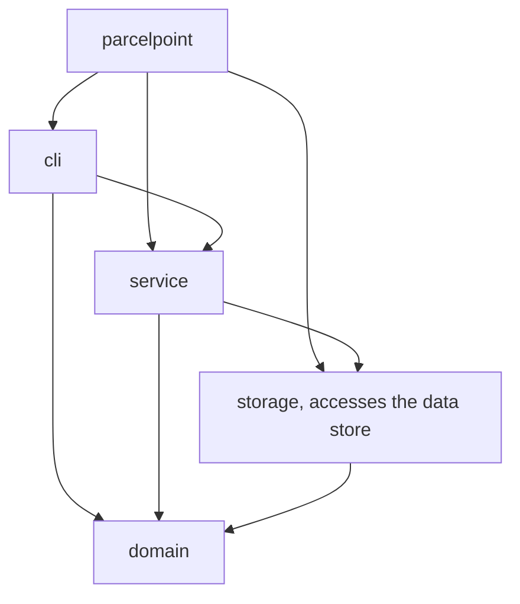
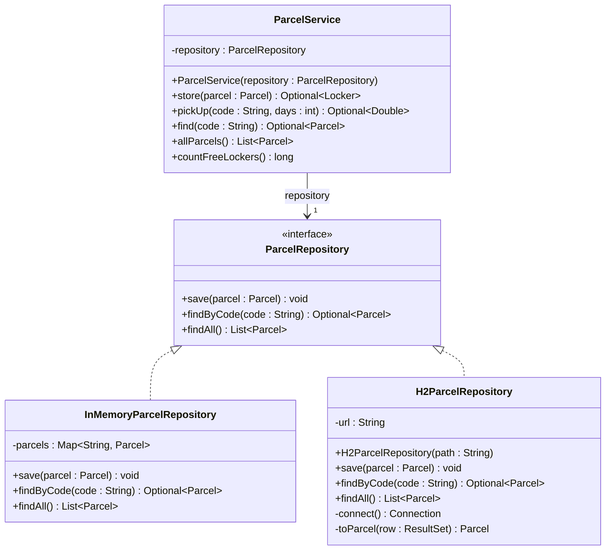
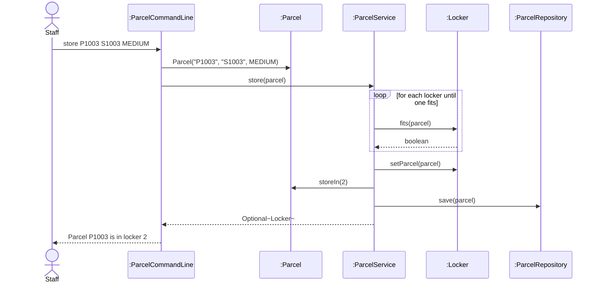

# Lab Report, Designing the Data Management Layer with H2

Repository URL: https://github.com/ZBWY10/itcs382-h2-lab

## Tools

| Item | Version or name |
| --- | --- |
| JDK | OpenJDK 25.0.5 (GitHub Codespaces) |
| Maven | Apache Maven 3.10.0 (GitHub Codespaces) |
| IDE | Visual Studio Code 1.146.0 for the Web, in GitHub Codespaces |
| AI tool and exact model, if you used one | Claude Opus 5.5 (claude-opus-5-5), Anthropic |

## Part 0. From a store in memory to H2

Commit of the starter, before any change: 57b5f74

0.3 Your prediction for `staff`, written before the second run:

I predicted that `staff` would list no parcels and show `Free lockers: 3`, because the program had ended and the parcels were only held while it ran.

Output of the second run, for `staff` and `quit`:

```text
> staff
Free lockers: 3
> quit
```

State in one sentence where you think the parcels of the first run were kept.

The parcels were kept in the `Map` field of `InMemoryParcelRepository`, which lives in the memory of the running program and is freed when the program ends.

0.5 The line of Main that you would change to keep the parcels somewhere else:

```java
ParcelRepository repository = new InMemoryParcelRepository();
```

0.6 Commit of the switch to H2: 00f7b1c

0.7 Output of `SELECT * FROM PARCEL;` after you stored two parcels:

```text
sql> SELECT * FROM PARCEL;
CODE  | STUDENT_ID | PARCEL_SIZE | STATUS | LOCKER_NUMBER
P1001 | S1001      | SMALL       | STORED | 1
P1002 | S1002      | LARGE       | STORED | 3
(2 rows, 22 ms)
```

0.8 Explain why ParcelPoint could not start while the H2 Shell was open, and identify the class that wrote the message `Cannot create the PARCEL table`.

H2 is an embedded database, so it belongs to the one program that opened it and locks the file `parcelpoint.mv.db` while that program is running. The H2 Shell still held the database open, so when ParcelPoint tried to open the same file, H2 refused with `Database may be already in use`. The message `Cannot create the PARCEL table` was written by the constructor of `H2ParcelRepository`, which catches the `SQLException` from H2 and wraps it in an `IllegalStateException` with that message.

0.9 Explain why `staff` shows no parcel while `find` shows each one, and why all three lockers look free.

`find` calls `findByCode`, which is fully implemented and reads the row from the PARCEL table, so both parcels are found. `staff` calls `findAll`, which in the starter was still a TODO that returned `List.of()`, an empty list, so it printed no parcel even though the rows exist in H2. The constructor of `ParcelService` puts each waiting parcel returned by `findAll` back into its locker; because `findAll` returned nothing, no locker received a parcel, so all three lockers looked free.

0.11 Your findAll method:

```java
@Override
public List<Parcel> findAll() {
    String sql = "SELECT * FROM PARCEL ORDER BY CODE";
    List<Parcel> parcels = new ArrayList<>();
    try (Connection connection = connect();
         PreparedStatement statement = connection.prepareStatement(sql);
         ResultSet row = statement.executeQuery()) {
        while (row.next()) {
            parcels.add(toParcel(row));
        }
    } catch (SQLException e) {
        throw new IllegalStateException("Cannot read the parcels", e);
    }
    return parcels;
}
```

Commit that adds findAll: 624cb4f

0.12 Output of `SELECT * FROM PARCEL;` after the pickup:

```text
sql> SELECT * FROM PARCEL;
CODE  | STUDENT_ID | PARCEL_SIZE | STATUS    | LOCKER_NUMBER
P1001 | S1001      | SMALL       | PICKED_UP | null
P1002 | S1002      | LARGE       | STORED    | 3
(2 rows, 21 ms)
```

0.13 Optional. Describe what `find P9999'OR'1'='1` showed while the SQL was joined from strings, and what it showed after you put the placeholder back.

While the SQL was joined from strings, `find P9999'OR'1'='1` showed `P1001, S1001, SMALL, PICKED_UP`, although no parcel has that code. The quotes in the input closed the text literal and added the condition `'1'='1'`, which is true for every row, so H2 returned all rows and `findByCode` showed the first one (SQL injection). After I put the `?` placeholder and `statement.setString(1, code)` back, the same input showed `No parcel with code P9999'OR'1'='1`, because H2 compared CODE with the whole text as one value.

## Part A. Model the design

A1 Complete the flowchart with one node for each package and one arrow for each dependency, from the package that uses to the package that is used. Mark the package that accesses the data store.



State whether cli depends on storage, and explain why.

No, cli does not depend on storage. `ParcelCommandLine` imports only classes from `domain` and `service`, and it reaches the parcels through `ParcelService`, so the user interface never touches the data management layer directly.

A2 Complete the class diagram of the data management layer with ParcelService, the interface ParcelRepository with its three operations, and the two classes that implement it.



A3 Draw a sequence diagram for the command `store P1003 S1003 MEDIUM`, from the staff member to the repository. Show each message as an operation of the class that receives it.



Explain why the last lifeline is the interface ParcelRepository rather than H2ParcelRepository.

`ParcelService` holds a field of type `ParcelRepository` and never names `H2ParcelRepository`, so the message `save` is sent to the interface, following the Dependency Inversion Principle. Which class answers is decided only in `Main`, so the same diagram stays correct whether the program uses the H2 store or the store in memory.

## Part B. Design questions

1. Identify the files that you changed to move from the store in memory to H2, and explain why no other class had to change. Use the terms of this course.

To switch the store I changed only `Main.java`, its import and the line that creates the repository; later I completed `findAll` in `H2ParcelRepository.java`, which is inside the data management layer. No other class changed because `ParcelService` depends on the abstraction `ParcelRepository` rather than on a concrete class (Dependency Inversion Principle), and it receives the repository through its constructor (dependency injection). `Main` is the one place that chooses the concrete class, so the data store is encapsulated behind the interface and the business layer and the cli are closed to this change.

2. The PARCEL table stores the size of a parcel as SMALL, MEDIUM or LARGE rather than as 1, 2 or 3. Identify the type of connascence between ParcelSize and the table in each case, and explain which one is weaker.

Storing the names gives connascence of name, because the table and `ParcelSize` must agree on the names that `ParcelSize.valueOf` turns back into sizes. Storing 1, 2 or 3 would give connascence of convention (and of position, if the number followed the order of the enumeration), because both sides must agree on what each number stands for. Connascence of name is weaker: the value is readable in the table, and adding or reordering constants in `ParcelSize` would not silently change the meaning of the stored rows.

3. Project Phase 2 asks for a data store that needs no separate server. Explain why an embedded database such as H2 meets this rule, and describe the limit of an embedded database that Step 0.8 showed.

H2 runs inside the program as a library, keeps its data in a local file, and creates its table on the first run with `CREATE TABLE IF NOT EXISTS`, so nothing has to be installed or started besides the program itself. The limit shown in Step 0.8 is that the database belongs to the one program that opened it: H2 locks the file, so a second program, such as the H2 Shell and ParcelPoint at the same time, cannot open it.

4. State the data store that you would choose for your Project Phase 2 team, files or an embedded database, the requirement that drives the choice, and the package that will access it.

I would choose an embedded database, H2, because our project must keep records after the program ends and look them up and update them by a key, which SQL with a primary key and MERGE handles directly without writing our own file format. The package `storage` will be the only package that accesses the data store, behind a repository interface that `Main` connects to the service layer.

## AI usage declaration

| AI tool and exact model | Date | Purpose | Files or answers it produced or changed | How you checked its output |
| --- | --- | --- | --- | --- |
| Claude Opus 5.5 (claude-opus-5-5), Anthropic | 14 November 2026 | Explain the lab steps, write findAll, draft the diagrams and the written answers, and run the build, the program and the H2 Shell in GitHub Codespaces to commit each step | `Main.java`, `findAll` in `H2ParcelRepository.java`, answers 0.3 to 0.13, A1 to A3, B1 to B4 | Built with mvn package in GitHub Codespaces and ran store, staff, find and pickup, comparing each output with the lab sheet; ran SELECT and SHOW COLUMNS in the H2 Shell to confirm the rows; reproduced the database lock of Step 0.8 and the SQL injection of Step 0.13, then restored the placeholder; checked each import line of every Java file against the A1 arrows; rendered A1, A2 and A3 on mermaid.live; reread each written answer against the code of ParcelService and H2ParcelRepository |
